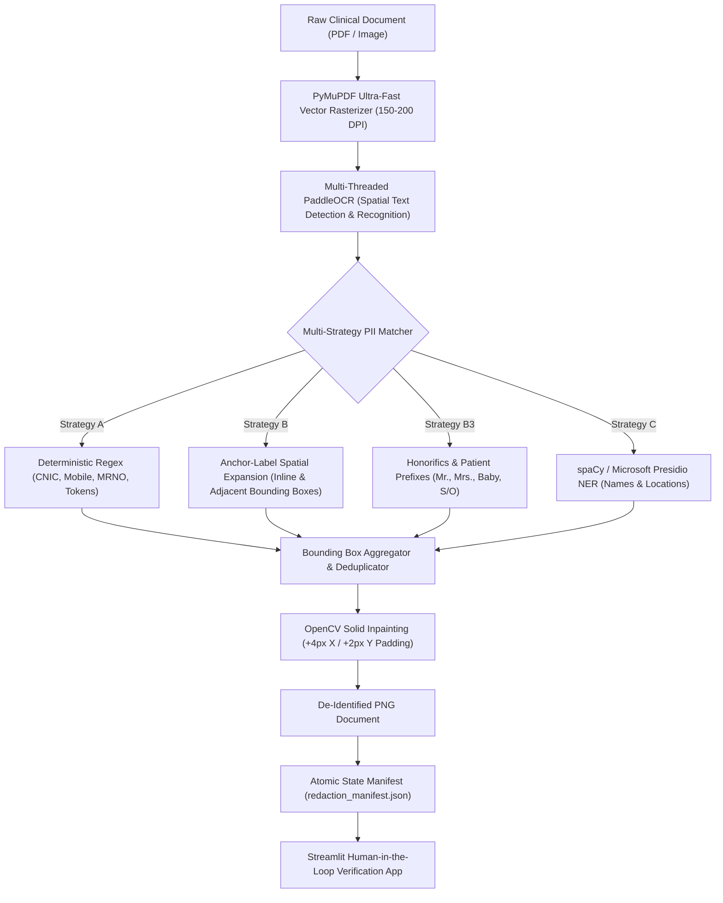

<div align="center">

# 🛡️ SehatKosh Medical Document De-Identification Pipeline

**An air-gapped, offline, multi-strategy PII de-identification engine and human-in-the-loop audit interface for clinical documents, medical receipts, and prescriptions.**

[](https://opensource.org/licenses/MIT)
[](https://www.python.org/)
[](https://github.com/PaddlePaddle/PaddleOCR)
[](https://github.com/microsoft/presidio)
[](https://streamlit.io/)
[]()
[](CONTRIBUTING.md)

</div>

---

## 📌 Overview

Clinical datasets and medical receipts contain critical Protected Health Information (PHI) and Personally Identifiable Information (PII) — including patient names, national identities (CNICs), contact numbers, admission dates, and hospital IDs. 

Cloud OCR APIs (AWS Textract, Google Vision, Azure) carry per-page costs, latency, and compliance challenges regarding data cross-border transfers. **SehatKosh De-Identification Pipeline** provides an end-to-end, local, 100% offline de-identification pipeline equipped with:
- **PyMuPDF direct rasterization** (~0.4s/page).
- **Local PaddleOCR** (`PP-OCRv4` Mobile / `PP-OCRv6` Medium).
- **Multi-Strategy PII matcher** combining deterministic Regex, Anchor-Label Spatial Expansion, and local Named Entity Recognition (`spaCy` + `Microsoft Presidio`).
- **Interactive Streamlit Human-in-the-Loop Audit Tool** for rapid side-by-side inspection, approval, flagging, and audit CSV exports.

---

## 🏗️ Architecture & Processing Workflow



---

## ⚡ Performance Benchmark

Tested on consumer-grade workstation hardware (**Intel Core i5-7300HQ 4-Core CPU @ 2.50GHz, 20GB RAM, Ubuntu 24.04 via WSL2**):

| Pipeline Stage | Model / Tool | Average Latency | Notes |
| :--- | :--- | :--- | :--- |
| **PDF Rasterization** | PyMuPDF (`fitz`) | **~0.4s** / page | 10x faster than `pdf2image` + `poppler` |
| **OCR Text Extraction** | PaddleOCR `PP-OCRv4` Mobile | **~5–10s** / doc | Safe multi-threaded CPU mode (`enable_mkldnn=False`) |
| **NER Processing** | spaCy `en_core_web_sm` + Presidio | **~0.2s** / doc | Pre-filters medical stopwords (`mg`, `tab`, `iv`, etc.) |
| **End-to-End Pipeline** | Full Batch Processing | **~8–12s** / doc | Fully processed 2,717 hospital PDFs in ~3 hours |

---

## 📁 Repository Structure

```
.
├── .github/
│   ├── ISSUE_TEMPLATE/
│   │   ├── bug_report.md
│   │   └── feature_request.md
│   └── PULL_REQUEST_TEMPLATE.md
├── Data/                       # Local raw PDFs (strictly git-ignored)
├── redacted_documents/         # Output de-identified images & manifests (git-ignored)
├── batch_redact.py             # Main batch de-identification pipeline
├── streamlit_audit.py          # Interactive side-by-side human audit web app
├── run_redaction.sh            # WSL2 / Linux launcher for batch redaction
├── run_audit.sh                # WSL2 / Linux launcher for Streamlit audit UI
├── run_redaction.bat           # 1-Click Windows shortcut for batch redaction
├── run_audit.bat               # 1-Click Windows shortcut for Streamlit audit UI
├── requirements.txt            # Python dependencies
├── .gitignore                  # Production Git ignore configuration
├── LICENSE                     # MIT Open Source License
├── CONTRIBUTING.md             # Contribution guidelines
├── CODE_OF_CONDUCT.md          # Contributor Covenant Code of Conduct
├── SECURITY.md                 # Security & healthcare privacy policy
└── README.md                   # Project documentation
```

---

## 🚀 Quick Start

### 1. Prerequisites
- **Operating System**: Linux, macOS, or Windows with WSL2 (Ubuntu 20.04/22.04/24.04 recommended).
- **Python**: 3.10, 3.11, or 3.12.
- **System Packages**:
  ```bash
  sudo apt-get update && sudo apt-get install -y poppler-utils libgl1
  ```

### 2. Environment Setup
```bash
# Clone the repository
git clone https://github.com/AHSANooo/SehatKosh-Data-Cleaning.git
cd SehatKosh-Data-Cleaning

# Create and activate virtual environment
python3 -m venv redaction_env
source redaction_env/bin/activate  # On Windows PowerShell: .\redaction_env\Scripts\Activate.ps1

# Install dependencies
pip install --upgrade pip
pip install -r requirements.txt
python -m spacy download en_core_web_sm
```

---

## 🛠️ Usage

### Step 1: Place Input Documents
Place your raw clinical PDFs or scanned receipts into the [`Data/`](file:///d:/Projects/SehatKosh%20Data%20Cleaning/Data) directory:
```
Data/
├── 1.pdf
├── 2.pdf
└── ...
```

### Step 2: Run De-Identification

#### Option A: Windows 1-Click
Double-click [`run_redaction.bat`](file:///d:/Projects/SehatKosh%20Data%20Cleaning/run_redaction.bat).

#### Option B: Terminal / Linux / WSL2
```bash
./run_redaction.sh
```

#### Advanced CLI Options:
```bash
# Test on a small sample of 10 documents
python3 batch_redact.py --sample 10

# Force re-processing of already completed files
python3 batch_redact.py --force

# Adjust rasterization DPI (default: 150)
python3 batch_redact.py --dpi 200

# Switch to PP-OCRv6 medium models (slower, maximum accuracy)
python3 batch_redact.py --ocr_version PP-OCRv6

# Enable textline orientation angle correction (for skewed scans)
python3 batch_redact.py --angle_cls
```

De-identified documents are saved to [`redacted_documents/`](file:///d:/Projects/SehatKosh%20Data%20Cleaning/redacted_documents). The state tracker [`redaction_manifest.json`](file:///d:/Projects/SehatKosh%20Data%20Cleaning/redacted_documents/redaction_manifest.json) tracks progress atomically; if interrupted, it resumes automatically.

---

### Step 3: Run Human-in-the-Loop Audit UI

To verify de-identification quality and spot-check documents side-by-side:

#### Option A: Windows 1-Click
Double-click [`run_audit.bat`](file:///d:/Projects/SehatKosh%20Data%20Cleaning/run_audit.bat).

#### Option B: Terminal / Linux / WSL2
```bash
./run_audit.sh
```
Open **[http://localhost:8501](http://localhost:8501)** in your browser.

**Audit UI Capabilities:**
- 🔍 **Side-by-Side Verification**: Displays the unredacted original document next to the de-identified output.
- ✅ **One-Click Decisions**: `Approve & Next` or `Flag & Next` (with custom reviewer notes).
- 🎛️ **Workflow Filters**: Filter documents by `Only Flagged` or `Only Pending`.
- 📊 **Audit Trail**: Real-time progress counters and one-click `audit_review.csv` export.

---

## 🔒 Privacy & Compliance Guarantees

- **100% Air-Gapped & Offline**: Zero external network requests during OCR inference or NER processing.
- **Data Confidentiality**: Input documents inside [`Data/`](file:///d:/Projects/SehatKosh%20Data%20Cleaning/Data) are read-only and never modified.
- **Git Shield**: Built-in `.gitignore` rules prevent accidental commits of raw or processed patient documents.

---

## 🤝 Contributing

We welcome community contributions! Please read our [Contributing Guidelines](CONTRIBUTING.md) and [Code of Conduct](CODE_OF_CONDUCT.md) before submitting pull requests.

---

## 📄 License

This project is licensed under the [MIT License](LICENSE) - see the [LICENSE](LICENSE) file for details.
